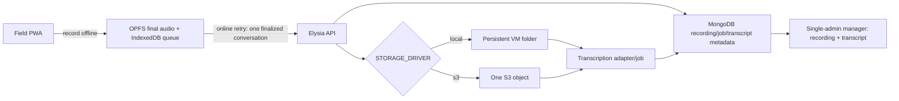

# Implementation plan

## Current baseline and approved next scope — 2026-11-19

This section records the actual repository state and narrows the next implementation increment. It supersedes the broader proposed insight-extraction work in Phases 5–6 for the immediate deliverable: preserve the current PWA and manager experience, add durable storage and one administrator, transcribe completed recordings, and show those transcripts in the manager. Do not add automated sales insight extraction, new reporting metrics, tenant isolation, or extra account roles in this increment.

### Desired vertical slice

1. A field representative records one conversation. Recording works without connectivity and the completed, merged audio file is saved to OPFS with its recording metadata in IndexedDB.
2. Reconnect resumes the queued upload. Transport may retry in pieces, but storage contains exactly one finalized conversation audio object, not a collection of user-visible recordings or separate clip objects.
3. The API selects a server-side storage adapter from `STORAGE_DRIVER=local|s3`. `local` writes the one final file to a configured persistent directory on the API machine/VM. `s3` writes the same logical recording as one final S3 object under the configured prefix. Credentials never reach the PWA.
4. After confirmed storage, MongoDB stores the recording metadata and storage reference. Store a bucket/key (or local relative key), never a long-lived or expiring presigned URL. Generate short-lived playback URLs when requested.
5. A transcription job consumes that completed recording through a provider adapter. Persist job state, transcript text/segments, language and timestamps/confidence when supplied, provider reference, and error/retry information in MongoDB.
6. The manager shows real recordings and their transcription state/transcript. Seeded synthetic reports remain clearly marked as synthetic and cannot masquerade as the transcript of a newly captured recording.
7. The manager has a one-time/bootstrap path to create the single administrator account. There is no public multi-user signup, tenant model, or tenant-specific storage configuration in this phase.



### What is already implemented

| Area | Present implementation | Boundary / limitation |
| --- | --- | --- |
| Workspace | Bun workspaces, Turborepo, typed React/Vite apps and shared domain/contracts/client/charts/demo-data packages; Hanken Grotesk bundled. | Elysia is pinned to `2.0.0-rc.3`; retain the lock and follow the repository Elysia instructions for API changes. |
| Field PWA | Record/pause/resume/stop/history; OPFS stores one merged audio file and IndexedDB stores metadata/retry state. Indexed chunk transport resumes on reconnect and marks uploaded only after API confirmation. | Device/browser OPFS behavior still needs real handset/offline deployment verification. |
| Local/S3 storage | `STORAGE_DRIVER=local|s3` selects one API storage adapter. The API assembles bounded transport chunks and writes one final dated conversation object; local playback is authenticated and S3 playback uses short-lived URLs. | No successful live AWS write has been verified. Region/bucket are not credentials. |
| Manager | Overview and Conversation Insights are distinct; ApexCharts, evidence drill-down, capture history, manual text import, and synthetic seed reports exist. Real uploaded recordings show transcript state/text separately, with retry for retryable failures. | The aggregate report charts remain synthetic/demo data. They must stay labeled as such and must not be presented as new audio-derived metrics. |
| Manual transcript analysis | API accepts consented text and deterministic rules produce a typed evidence-linked report; optional VTT/SRT timings and conversation date are supported. | This is not audio transcription. The rule analyzer must not be presented as an ASR result or used to fabricate a transcript for PWA audio. |
| API persistence | MongoDB stores visits, recordings, one administrator, sessions, and transcription jobs/transcript text. Audio bytes remain in local/S3 object storage. | Manual text-import report aggregation remains process-local demo data. Live Mongo persistence needs configured service verification. |
| Authentication | One-time protected administrator bootstrap, password login, expiring hashed sessions, manager route protection, and sign-out are implemented. | One admin only; no tenant model, user roles, or public account signup. |
| Transcription | Finalized stored audio queues a mandatory pyannote Community-1 diarization job on Modal, followed by OpenAI `gpt-transcribe` requests for speaker clips; job state, speaker turns, and transcript text persist in Mongo. | API startup requires Modal credentials, FFmpeg, and an OpenAI key. No OpenAI diarization is requested. Audio over 10 minutes remains stored but cannot be transcribed by the current diarization service. |

### Repository inventory at planning time

The following is the exact Git working-tree inventory at the time this addendum was written. Do not discard these uncommitted changes while implementing the plan.

**Modified tracked files (uncommitted):**

- `apps/api/src/app.ts` — adds local chunk receive/finalize routes and injects local storage; check health/storage semantics and state transitions.
- `apps/field-pwa/src/main.tsx`, `apps/field-pwa/src/styles.css` — chunk-progress queue UI and upload progress wiring.
- `apps/field-pwa/src/sync/audio-upload.ts` — uses client chunk upload rather than direct presigned S3 PUT.
- `packages/api-client/src/index.ts` — chunk upload route/client callback.
- `docs/implementation-plan.md` — this current-state inventory and narrowed S3/MongoDB/transcription plan.

**Untracked source:**

- `apps/api/src/services/local-recording-storage.ts` — local date-partitioned audio storage and chunk assembly.

**Untracked generated audio artifacts:**

- `apps/api/uploads/recordings/2026/11/18/1b40873f-7381-42ae-b580-2978d9a77cde.webm` (124,887 bytes)
- `apps/api/uploads/recordings/2026/11/18/4efd0d82-c9b0-4a74-944a-18f1a6d9a2c7.webm` (76,225 bytes)
- `apps/api/uploads/recordings/2026/11/18/4ca2e8dd-69d0-4d5a-87f0-c9f2973e407d.webm` (48,200 bytes)

These are audio files, not source code. Treat them as potentially real user recordings: do not inspect, attach, stage, commit, or delete them as part of implementation without explicit direction. Add the upload directory to `.gitignore` before future local capture artifacts can be staged accidentally.

**Committed code surface (high-level):**

- `apps/field-pwa/src/{main.tsx,styles.css,storage/**,sync/**,pwa/**}`: recording UI, OPFS/IndexedDB, metadata and audio sync.
- `apps/api/src/{app.ts,index.ts,repositories/**,services/**}`: Elysia API, in-memory repositories, S3 adapter, deterministic manual-transcript analyzer.
- `apps/manager/src/**`: overview, insights, chart/report UI, capture history and transcript import/detail.
- `packages/{domain,contracts,api-client,demo-data,charts,ui}/**`: shared types, client, synthetic data and UI/chart packages.
- `apps/api/.env.example`, `docs/s3-upload-setup.md`, `PRODUCT.md`, `DESIGN.md`, `docs/subagent-strategy.md`, and this plan document: environment/setup, product/design context and planned delivery.

At the committed baseline, HEAD is `eedb029 feat: add manual transcript insights and S3 storage`; the preceding commits are `5402d0c feat: upload field recordings to S3`, `ce65e4c fix: align local demo service ports`, `1988722 feat: build field capture and reporting demo`, and `62b75a2 docs: define sub-agent delivery strategy`. The workspace was dirty at plan time; the changes listed above are not included in HEAD.

### Revised phase plan

| Phase | Deliverable | Owned scope / acceptance gate |
| --- | --- | --- |
| A — Contract and recovery baseline | Freeze one recording lifecycle: OPFS queued → uploading → stored → transcribing → transcript ready/error. Define stable IDs, idempotency, storage reference, transcript fields, and API response schemas. Decide whether existing chunk requests remain transport-only; final local/S3 storage must be one merged audio object. Protect untracked audio artifacts and ignore the upload directory. | Lead owns `packages/domain`, `packages/contracts`, endpoint/state decisions and Git inventory. No parallel implementation until contracts are agreed. |
| B — MongoDB and storage adapters | Add MongoDB connection/config, indexes and repositories for the one admin, recording metadata, transcription job, transcript, and global storage settings. Add a `RecordingStorage` interface with `local` and `s3` adapters selected by validated `STORAGE_DRIVER`. Local paths must be rooted under `LOCAL_RECORDING_DIR`, non-public, date/id partitioned, and persistent in deployments. S3 uses server-issued authorization or API proxy upload and stores one object per finalized conversation. | API/platform owner. Acceptance: switching only the storage enum changes the backend adapter; invalid values fail startup; Mongo stores references/metadata rather than audio bytes or presigned URLs; one final audio object is recoverable after API restart. |
| C — PWA upload reconciliation | Keep OPFS/IndexedDB as the offline source of truth. On reconnect, upload only finalized merged audio, with stable idempotency and resume/retry semantics. Preserve per-chunk progress only as transport telemetry; never create multiple final recordings. Mark remote completion only after API confirms durable write and Mongo metadata. | Field PWA owner, coordinated with Phase B API contracts. Acceptance: airplane-mode capture survives reload; reconnect produces one final local file or one S3 object and one Mongo recording document; failure leaves OPFS copy queued and visibly retryable. |
| D — Single-admin setup | Add one-time administrator bootstrap/account creation in the manager/API, password hashing, authenticated session, protected manager/API routes, logout, and setup-disabled behavior once the first admin exists. No tenant collection, tenant IDs, multi-user/team roles, or tenant-scoped storage config. Storage mode is one server-level environment setting. | API auth owner plus manager owner after session contract approval. Acceptance: first-run creates the one admin; repeat/public creation is refused; unauthenticated users cannot access admin data; no secrets are shipped to Vite. |
| E — Audio transcription | Choose and verify an approved ASR provider, supported region/languages, account permissions, consent/data residency, cost and retry behavior. Implement provider interface and asynchronous job triggered only after storage confirmation. Persist job state and provider transcript in Mongo. In local mode, provider worker reads the local final file; in S3 mode, it reads that single S3 object. Provide a deterministic fake provider only for tests/demo fallback and label it clearly. | Transcription owner after Phase A schema and Phase B storage completion. Acceptance: a real PWA recording transitions to transcribing and then ready/error; transcript includes segment text and timestamps/speakers/confidence only where provider supplies them; retries are idempotent. |
| F — Manager transcript experience | Add a real recordings/transcripts view or extend current visit detail: capture metadata, storage/sync state, transcription state, transcript text/segments, timestamps/speaker labels and retry/error status. Preserve existing dashboards and synthetic fixture indicators. Show live transcripts as live, never splice synthetic insight quotes into them. Keep manual transcript import separate and labeled. | Manager owner consumes the stable API only. Acceptance: a newly recorded conversation appears in the manager with its own transcript after transcription; loading/empty/error states work; synthetic demo charts remain explicitly synthetic. |
| G — Integrated demo verification and handoff | Exercise PWA → OPFS offline → reconnect → selected storage adapter → Mongo document → transcription job → persisted transcript → manager detail. Test local mode and S3 mode separately, API restart recovery, duplicate/retry behavior, invalid storage env, provider failure, and synthetic/live labeling. Document required env and commands. | Lead integrates, runs the requested verification, reconciles evidence, and records the final phase commit. |

### Execution sequence and commit gates

The user has now approved implementation and requested a commit after every completed phase. Follow this narrower sequence; finish and commit each phase before opening dependent feature work. The lead owns every integration commit. Sub-agents may implement bounded work but do not commit directly.

| Execution phase | Work and exit gate | Commit subject |
| --- | --- | --- |
| 0 — Repository recovery | Keep local recording files on disk but remove them from Git tracking; ignore API upload/runtime directories. Completed as `f4eaa58`. | `chore: ignore local recording artifacts` |
| 1 — Mongo + storage foundation | Async repository contract; persistent visits/recordings; strict `STORAGE_DRIVER`; one local or S3 final-object adapter; API runtime wiring and env docs. Confirm the service never writes audio bytes to Mongo and upload chunks remain temporary transport only. | `feat: persist recordings with configurable storage` |
| 2 — PWA sync integration | Reconcile existing OPFS chunk transport with the selected storage adapter; add safe idempotency, digest/size validation, one final object, status copy driven by server config, and durable completion before PWA marks uploaded. | `fix: resume recording sync to configured storage` |
| 3 — Single administrator | First-run account setup, password hashing, login/logout, protected manager routes/session, and setup closure after first account. No tenant/user-role system. | `feat: add single-admin account setup` |
| 4 — OpenAI transcription | Async transcription job after durable audio storage; server-only `OPENAI_API_KEY`; use the current OpenAI Audio Transcriptions API with `gpt-transcribe`; persist transcript and status in Mongo. | `feat: transcribe stored recordings with OpenAI` |
| 5 — Manager transcript display | Show live recording metadata, transcript state, and actual transcript text in the manager; loading, empty and failure states; synthetic fixtures stay visibly synthetic. | `feat: display recording transcripts in manager` |
| 6 — End-to-end handoff | Verify local and S3 storage paths where credentials/services are available, offline recovery, Mongo restart persistence, one-object idempotency, OpenAI success/failure, and manager rendering; update runbook and acceptance notes. | `docs: document recording transcription workflow` |

The API retains one final audio object and uses pyannote's speaker timeline to send bounded clips to OpenAI for text recognition. Do not send fabricated speaker labels, timestamps, or confidence when a provider does not supply them. Store and display transcript text with provider/model, diarizer provenance, and language only when supplied.

### Configuration contract to implement

Required global API settings:

```dotenv
STORAGE_DRIVER=local # exactly local or s3
LOCAL_RECORDING_DIR=./var/recordings
MONGODB_URI=mongodb://127.0.0.1:27017
MONGODB_DATABASE=itc_field_source
```

S3 mode additionally requires `AWS_REGION`, `S3_BUCKET_NAME`, and recording prefix settings; the API obtains credentials from its runtime role/profile/credential chain. Do not put AWS credentials in PWA or manager environment variables. The `.env.example` should document mutually exclusive storage modes and startup validation. The one-time admin bootstrap secret/account setup requirements must be documented without committing a password or real secret.

MongoDB should store a recording document with stable recording/visit IDs, consent timestamp, representative/outlet/territory metadata, byte length, duration, MIME type, checksum, storage driver, object key or local relative path, sync/analysis state, and timestamps. Transcript/job data should be separate or cleanly nested with provider job ID, transcript segments, language, completion/error state and provenance. Add unique indexes for stable IDs/idempotency and query indexes for history/status. Signed S3 URLs are minted on demand and not persisted as permanent links.

### Agent strategy for the approved implementation

Use the existing strategy in `docs/subagent-strategy.md`, adjusted to this narrower scope. The lead freezes contracts first and integrates; then use at most three sub-agents concurrently with non-overlapping path ownership:

| Agent | Assignment after Phase A | Owned paths | Must not do |
| --- | --- | --- | --- |
| API persistence/storage | Mongo connection, repository interfaces/adapters, storage enum validation, local/S3 final-object implementations, upload completion and API persistence. | `apps/api/src/repositories/**`, new storage/database service modules; request shared route/type changes from lead. | Edit PWA upload logic or manager screens; create tenancy; persist expiring S3 URLs. |
| Field PWA | OPFS queue lifecycle, single-file upload/retry/resume, network state, chunk progress UI and API client integration. | `apps/field-pwa/**`; propose API client changes instead of independently changing shared contracts. | Store each transport chunk as a separate final conversation object or mark uploaded before server confirmation. |
| Transcription + manager | Provider adapter/job lifecycle on API-owned transcription files, then manager transcript presentation in a later wave with separate ownership. | Wave 1: new API transcription service/provider files. Wave 2: `apps/manager/**` transcript view after API shape freezes. | Edit `apps/api/src/app.ts` concurrently with API owner; alter existing report semantics or synthetic labels. |
| Lead / integration | Contract/schema, Elysia route wiring, env/docs, single-admin design and integration, exact scope decisions, final runbook and commit. | `packages/domain/**`, `packages/contracts/**`, shared route wiring, root/env/docs; coordinate handoffs for contested files. | Let shared contract ownership drift or start dependent UI before API shapes are agreed. |

Recommended waves: (1) lead contract/spec and storage mode decision; (2) API/Mongo-storage and PWA upload work in parallel against that contract; (3) transcription provider adapter after completed-object contract is stable; (4) manager auth/session and transcript display against persisted API response; (5) lead end-to-end integration, local/S3 mode verification, and commit. Keep `bun.lock`, `apps/api/src/app.ts`, shared types, and auth/session contracts single-owner at a time.

### Proposed acceptance checklist

- `STORAGE_DRIVER=local` and `STORAGE_DRIVER=s3` are the only accepted values and startup/config diagnostics identify the chosen driver without exposing credentials.
- Each finalized visit audio results in exactly one merged recording file/object. Chunk retries do not multiply final artifacts or Mongo documents.
- Offline recordings persist in OPFS across reload; reconnect sync is resumable and confirms server durability before local state becomes uploaded.
- MongoDB persists the one admin, recording/storage reference, transcription job and transcript across API restarts.
- A PWA recording is transcribed by the selected provider and the transcript is visible in the manager with honest pending/failed/ready states.
- Existing synthetic reports remain labeled and unchanged in meaning; newly captured audio never receives a synthetic transcript or insights.
- No multi-tenant behavior is introduced. There is one administrator and one global storage driver for this deployment.
- Local storage files and captured audio artifacts are excluded from Git; no credentials, transcript/audio payloads, or user media are committed.
- Verify typecheck/build plus a local-mode and S3-mode end-to-end recording path, Mongo persistence after restart, transcription success/failure, and single-object/idempotency behavior.

### Proposed commit subject

After implementation and verification, suggested cohesive commit:

```text
feat: persist recordings and display live transcripts
```

The plan is approved for implementation. Use the execution sequence and per-phase commit subjects above; keep captured audio artifacts outside Git staging.

## 1. Outcome and product boundary

Build a demo-ready, typed monorepo with two connected product surfaces: an offline-capable field recording PWA and a managerial conversation reporting dashboard. The core proof is that a field conversation can be preserved through loss of connectivity, synchronized safely, transcribed, converted into structured, evidence-backed signals, and reviewed by a manager.

The demo must distinguish three states that are easy to conflate:

1. A recording is present on the device.
2. Its audio has reached the configured object store.
3. Transcription and analysis have completed and the report is reviewable.

An uploaded recording is not automatically an analyzed conversation. Synthetic fixtures must be labeled, and live audio must not be shown with invented transcript or insight results.

## 2. Current stack and workspace boundaries

- **Workspace/package manager:** Bun workspaces and Bun lockfile; no Corepack or pnpm.
- **Task graph:** Turborepo for workspace builds, type checks, and parallel development servers.
- **Web apps:** React, TypeScript, and Vite; separate manager and field PWA deployments.
- **API:** Elysia 2 release candidate on Bun, with request/response validation defined from shared schemas. Pin the resolved version in bun.lock and recheck its official docs when the package lock changes.
- **Visualization:** ApexCharts through React-ApexCharts, wrapped in the shared typed charts package.
- **Typography:** Hanken Grotesk, bundled locally.
- **Shared packages:** domain, contracts, API client, UI, charts, and synthetic demo data.
- **Agent guidance:** project-local Impeccable and Elysia skills; product/design context lives in PRODUCT.md and DESIGN.md.

The committed Bun lockfile records the exact dependency graph. This scaffold resolves Bun 1.4.2, Turborepo 2.11.12, Vite 8.3.8, and Elysia 2.0.0-rc.3. Elysia 2 is still a release candidate, so re-evaluate the pin once a stable release is available before production deployment.

The web clients use the API as the shared source of truth. OPFS is a device-side durable queue for audio bytes, not a cross-device data store. The server owns uploaded recording metadata, analysis jobs, transcripts, insights, and manager reporting.

## 3. Phase map

| Phase | Name | Main result | Depends on |
| --- | --- | --- | --- |
| 0 | Workspace and project context | Bun/Turborepo skeleton, app shells, shared packages, design and product briefs | Current task |
| 1 | Domain, API contracts, and persistence | Typed models, Elysia route layout, database schema, local demo seed | 0 |
| 2 | Design system and visual foundations | Impeccable-informed design rules, reusable accessible UI, Hanken typography | 0–1 |
| 3 | Field capture PWA | Installable mobile workflow with record, pause, stop, and history | 1–2 |
| 4 | Offline storage and upload sync | OPFS/IndexedDB queue and retry-safe S3 transfer | 1, 3 |
| 5 | Transcription and conversation insight pipeline | Audio-to-transcript-to-structured insight job lifecycle | 1, 4 |
| 6 | Manager reporting and ApexCharts | Evidence-first overview, drill-downs, filters, and chart suite | 1, 2, 5 |
| 7 | End-to-end demo readiness | Seeded story, offline demonstration controls, integrated walkthrough | 3–6 |
| 8 | Hardening and deployment handoff | Operational, privacy, accessibility, and deployment readiness | 3–7 |

## 4. Phase 0 — Workspace and project context

**Status:** completed in this scaffold task. Later phases remain planned and are not implemented yet.

### Work

- Pin Bun in the root package manifest and define apps/* and packages/* workspaces.
- Configure Turborepo tasks for persistent dev servers, dependency-aware builds, type checks, and clean-up.
- Create app shells for field PWA, manager dashboard, and Elysia API, with distinct ports and focused Bun scripts.
- Create typed package boundaries for domain models, API contracts/client, shared UI, charts, and demo fixtures.
- Establish PRODUCT.md and DESIGN.md so later UI and reporting work shares one user and design context.
- Add the user-requested skills with the requested commands: npx skills add pbakaus/impeccable for design guidance and bunx skills add elysiajs/skills for Elysia guidance. Review the resulting skill instructions before following them; preserve the install/lock metadata if the CLI creates it.
- Generate and commit bun.lock after registry access is available. The environment must not silently fall back to npm, pnpm, or Corepack.

### Exit criteria

- Bun recognizes all workspace packages and can run the three app dev scripts.
- Turbo sees the same workspace graph and package dependency edges.
- Each app and package has TypeScript settings and named scripts.
- Product and design briefs state the intended audience, evidence policy, typography, and field workflow.
- Skill installation result and dependency lock status are documented. If a protected skill directory or registry access blocks installation, report that limitation rather than claiming the skill is installed.

## 5. Phase 1 — Domain, API contracts, and persistence

### 5.1 Domain model

Define shared, versionable entities before building the screens:

- **Visit:** representative, outlet, territory, start/end time, consent event, visit context, and declared outcome.
- **Recording:** stable recording ID, local/device ID, MIME type, byte length, duration, OPFS filename, S3 object key, checksum, upload state, and analysis state.
- **Transcript segment:** segment ID, speaker label, start/end offsets, text, language, and speech recognition confidence.
- **Insight:** category, normalized entity/value, countable signal, source recording/segment references, extracted quote, confidence, suggested action, model/provider metadata, review state, and correction history.
- **Order/commitment:** source attribution, amount or product reference when stated, explicit versus inferred status, owner, and due date.
- **Analysis job and sync event:** idempotency key, attempts, timestamps, errors, and state transitions for operational visibility.

Avoid putting API SDK objects, browser handles, or chart-library types in the domain package.

### 5.2 API shape

Design typed Elysia 2 route groups for health, authentication/session, reference data, visits, upload authorization/completion, recording status, transcripts, insights, and manager reports. Use Elysia schemas for runtime validation, inferred TypeScript types, and generated API documentation from one contract source. Add pagination and explicit filters to list/report endpoints. Follow the Elysia v2 skill and current v2 documentation rather than applying v1 examples.

Suggested initial routes:

- GET /health
- GET /v1/me and GET /v1/reference-data
- POST /v1/visits and POST /v1/visits/:visitId/recordings
- POST /v1/recordings/:recordingId/upload-authorizations
- POST /v1/recordings/:recordingId/upload-complete
- GET /v1/recordings and GET /v1/recordings/:recordingId
- GET /v1/recordings/:recordingId/transcript and GET /v1/recordings/:recordingId/insights
- GET /v1/reports/overview, /signals, /outcomes, /team, and /follow-ups

### 5.3 Persistence

Choose a relational schema with explicit migrations. Separate the audio object in S3 from searchable metadata and analysis records in the database. Start with synthetic seed data for the manager report and deterministic IDs so demo views are repeatable. Keep a local-development configuration separate from deployed credentials.

### Exit criteria

- Shared types describe the lifecycle from visit capture through analyzed insights.
- Elysia validates input and response shapes at route boundaries.
- A seeded report can be returned by the API without relying on chart or UI code.
- Each insight points back to one or more transcript segments or is explicitly marked as unavailable/unverified.

## 6. Phase 2 — Design system and visual foundations

### Work

- Apply the Impeccable skill’s product-aware design workflow: inspect the product context, establish hierarchy, critique the result, and record reusable decisions in DESIGN.md.
- Treat both products as Operate surfaces. Use the Impeccable new-work workflow to settle each surface’s composition before implementing feature UI; the shell CSS is not the final visual direction.
- Bundle Hanken Grotesk locally so typography survives offline app-shell use.
- Define tokens for color, type scale, spacing, borders, focus, elevation, status, and chart series.
- Build shared accessible primitives: app shell, navigation, buttons, form fields, status badges, tables, empty/loading/error states, filter controls, drawers, and evidence/quote blocks.
- Make manager desktop-first but responsive; make field capture mobile-first, thumb-reachable, and usable in bright outdoor conditions.
- Keep charts visually subordinate to their finding and show a table or text equivalent for important data.

### Exit criteria

- Both apps use the same token vocabulary and Hanken font assets.
- Keyboard focus, contrast, labels, error feedback, reduced-motion behavior, and narrow-screen behavior are addressed in shared primitives.
- The field recording action remains the strongest visual affordance on the capture screen.
- The dashboard gives the user a clear reading path from aggregate finding to the visits and quotes supporting it.

## 7. Phase 3 — Field capture PWA

### Capture flow

- Resolve representative identity from the session; allow outlet selection/search and optional route/visit context.
- Capture an explicit consent acknowledgment and timestamp before recording. The final wording and jurisdictional policy must be supplied by ITC before real field use.
- Request microphone access only after a user gesture; show denied, unavailable, and interrupted states.
- Support start, pause, resume, stop, elapsed time, and clear recording state. Prevent accidental second active recordings.
- Save a visit/recording record even when the audio is short or the network drops.
- Provide history with duration, outlet, time, local/upload/analysis state, retry action, and delete action according to retention policy.
- Include an optional development-only offline toggle for a controlled demo; also validate true browser offline mode.

### PWA behavior

- Add manifest, icons, service worker, app-shell caching, update handling, install affordance, and offline-safe routes.
- Cache the assets required to reopen capture/history; avoid caching authenticated API responses or transcripts without an explicit privacy design.
- Explain local storage state, available quota, and what happens when device storage is low.

### Exit criteria

- A representative can record a short audio visit and find it in history after reload.
- Recording control state remains correct through pause/resume and error interruptions.
- The interface never reports a remote upload or analysis result before the server confirms it.

## 8. Phase 4 — OPFS durability and S3 synchronization

### Local-first storage

- Stream MediaRecorder blobs into an OPFS file rather than retaining the entire audio in memory.
- Store metadata, chunk offsets/checkpoints, idempotency keys, and retry scheduling in IndexedDB.
- Use storage persistence where available and detect OPFS/quota support. If the required browser capability is absent, show a clear fallback or block recording with an explanation; do not claim OPFS durability when using a weaker path.
- Finalize metadata only after the file writer closes successfully; recover incomplete files after a browser crash.

### Upload protocol

- Ask the Elysia API for a short-lived pre-signed S3 upload authorization.
- Use retryable multipart/chunk upload for recordings large enough that a single transfer is fragile; persist part IDs and completed offsets locally.
- Include a checksum and server-validated content metadata. The API verifies the upload completion event and transitions the server record.
- Resume on app launch and online/network recovery; use bounded exponential backoff with jitter, cancellation, and a visible manual retry.
- Make completion idempotent. Do not mark a recording synced merely because the browser initiated the PUT.
- Keep S3 bucket credentials and provider secrets exclusively server-side; use least-privilege IAM and lifecycle/retention policies.

### Exit criteria

- A recording made offline survives app restart and later completes one server-recognized upload.
- A dropped transfer resumes or retries without duplicate recording metadata or corrupted audio.
- Local, uploading, remotely uploaded, transcription, and analysis states are separately visible.

## 9. Phase 5 — Transcription and conversation intelligence

### Provider boundary

Define TranscriptionProvider and InsightProvider interfaces. Use deterministic fixtures to exercise the pipeline in local demo mode. Choose the production/demo transcription and LLM providers after confirming approved vendor, data region, languages, privacy terms, and credentials. If AWS is the selected environment, the likely path is an S3-triggered asynchronous transcription job followed by a structured insight job; the provider adapters remain replaceable.

### Transcription pipeline

- Accept only completed, integrity-checked audio objects.
- Detect or configure language; evaluate English, Hindi, Kannada, and other field languages with ITC rather than assuming one language.
- Return timestamped speaker segments, language, provider/job IDs, and confidence where the provider supports them.
- Persist raw provider output separately from normalized transcript segments.
- Support failed, low-confidence, and partially complete states with a retry path.

### Insight extraction schema and taxonomy

For each conversation, extract the following with structured evidence and confidence. Preserve speaker and timestamp for each phrase, distinguish explicit statements from inference, account for negation, corrections, and code-switching, and normalize equivalent terms without losing the original words:

1. **Visit context and outcome:** visit purpose, order placed/no order/follow-up/new outlet, products discussed, explicit quantities or values.
2. **Retailer need and demand:** product/category, brand, SKU or variant, pack size, requested quantity, price point, preferred promotion, consumer ask, new-format request, purchase frequency, and whether it is an explicit request or a model inference.
3. **Availability and execution:** current stock statement, stock-out, assortment gap, shelf/display visibility, replenishment, delivery timing, product freshness/quality, and unresolved service issue.
4. **Objections and competitive context:** price/margin, discount, credit/payment cycle or days, competitor brand/product/price, product knowledge, perceived consumer demand, delivery, and other normalized categories. Preserve exact competitor names and stated amounts as entities.
5. **Interest and sentiment cues:** stated enthusiasm/hesitation, change during the conversation, and the transcript evidence that supports it.
6. **Commitments and next steps:** who promised what, due date if stated, manager/rep owner, and completion status.
7. **Conversation quality evidence:** whether the rep asked discovery questions, explained a benefit, addressed an objection, and agreed a close/next action. Any derived quality indicator must display the rubric and cited segments; it is a coaching aid, not an opaque person score.
8. **Opportunity signal:** potential value or probability only when backed by explicit data and a documented calculation; never merge inferred opportunity with booked sales.

Normalize products, packs, territories, objection labels, and outcomes so reports aggregate equivalent phrases. Store original quote and transcript segment IDs alongside normalized labels.

Keep both raw mention volume and distinct-visit prevalence. For example, five mentions in one visit are not five retailers with the same objection. Do not treat silence about a product, price, or concern as evidence of no demand or no objection. Normalize quantities, currency, dates, and pack units without discarding the spoken value, and keep conflicting statements visible for review instead of silently choosing one.

### Human review and quality gates

- Validate provider JSON against a strict schema and reject malformed/incomplete output.
- Require quote/segment provenance for every factual insight. Mark unsupported model statements as ungrounded and exclude them from aggregate counts.
- Store model name/version, prompt/schema version, processing time, confidence, and review/correction events.
- Provide manager correction and feedback capture in the conversation detail view.
- Keep identifiable audio/transcript access role-controlled; make retention and deletion behavior explicit.

### Exit criteria

- A seeded or provider-processed conversation has transcript segments and multiple typed insights with traceable quotes.
- Failed transcription/analysis does not block access to the recording or other dashboard data.
- Aggregate metrics count only valid, deduplicated insight records and communicate sample size/confidence.

## 10. Phase 6 — Manager reporting dashboard and ApexCharts

### Information architecture

- **Overview:** field pulse, high-value findings, team activity, sync/analysis health, and due follow-ups.
- **Conversation intelligence:** recurring demand/objection/availability/competitor themes with time and territory drill-down.
- **Conversation review:** transcript with audio playback, timestamp navigation, speaker labels, insight evidence, confidence, and review controls.
- **Team and territory:** aggregate coverage and coaching signals with minimum sample thresholds and evidence access.
- **Recordings and follow-ups:** upload/analysis pipeline, unresolved commitments, and exceptions requiring attention.

### ApexCharts visual suite

All charts must use shared typed option builders in @itc/charts, controlled color semantics, responsive breakpoints, tooltips with definitions, empty states, and synchronized report filters. Charts are a view of validated report API data; chart code does not compute business truth.

1. **Field pulse KPI strip:** visits, unique outlets, confirmed orders, follow-ups due, opportunity estimate (separate), analysis completion, and median sync lag. Show comparison window and denominator.
2. **Visit outcome funnel:** completed visits to explicit order, follow-up, and no-order outcomes; distinguish missing/unknown outcomes.
3. **Visit and analysis trend:** daily/weekly stacked bars for captured, uploaded, transcribed, analyzed, and failed visits, paired with time-to-sync/analyze line.
4. **Demand signal matrix:** heatmap of territory × product/category or pack-size request count, with outlet count, confidence, and minimum-sample handling.
5. **Objection mix:** horizontal ranked bars for objection categories, distinct-visit count, raw mention count, share of analyzed visits, and filter-by-category behavior.
6. **Objection trend:** stacked area or small-multiple line trends over the selected time range to show whether credit, margin, stock, or competitor objections are rising/falling.
7. **Retailer need and product mention:** ranked product/pack requests with explicit/inferred split, territory drill-down, and trend.
8. **Conversation sentiment distribution:** stacked bars/area by time or territory; never imply clinical emotion measurement, and show that these are model-labeled conversation cues.
9. **Follow-up aging:** due/overdue counts and age buckets, with drill-through to the commitment quote and owner.
10. **Conversation quality rubric:** transparent component distributions (discovery, benefit explanation, objection response, close/next step), evidence count, and confidence. Avoid leaderboard rankings by default.
11. **Competitor and pricing signals:** mentions of competing brand/product, quoted competitor price, discount/margin pressure, and trend by territory, shown only when a quote supports the extracted value.
12. **Evidence-backed insight cards:** concise narrative, frequency, affected outlets/territories, confidence, representative quotes, and recommended manager action; open the underlying visits.

### Dashboard interactions

- Global date range, territory, representative, product, outcome, and insight category filters.
- Chart selections update the related table or insight list and can be cleared visibly.
- Every visual has an accompanying accessible summary/table and CSV export of the currently authorized filtered data.
- Use explicit denominators and sample sizes; suppress or mark low-sample comparisons.
- Separate captured date, upload date, transcription date, and analysis date in reporting filters where relevant.
- Preserve filter state in URL/search parameters for shareable review links, subject to authorization.

### ApexCharts licensing gate

Before distribution, confirm ITC’s ApexCharts license terms for the intended commercial use. Current vendor terms distinguish community, commercial, and OEM redistribution rights; building an externally distributed chart-enabled product may require OEM rights. Keep the product’s own report data model and chart configuration separate from the library so another chart renderer can be substituted if procurement or legal review requires it.

### Exit criteria

- Dashboard cards and charts reconcile to the same report API aggregates.
- Selecting a data point lands on the exact supporting insight/visit set.
- Summary, sample size, confidence, and supporting evidence are available without relying on hover alone.
- The reporting view distinguishes orders from potential opportunities and fixture data from real records.

## 11. Phase 7 — Integration and demo readiness

### Demo story

1. Start in the manager overview and show a top-level field pulse.
2. Open one insight, such as repeated small-pack demand or a credit-cycle objection.
3. Filter by territory/product and show counts, affected outlets, confidence, and a transcript quote.
4. Open the conversation and jump from quote to timestamped transcript/audio.
5. Switch to the field app, capture a new short conversation, pause/resume, and stop.
6. Toggle offline or disable the network, capture a second visit, close/reopen the app, and confirm it remains queued locally.
7. Reconnect and show upload status, then explain the separate transcription and analysis states.
8. If credentials/provider config are unavailable, use a labeled synthetic report fixture; do not imply that the newly recorded sample produced that fixture insight.

### Integration work

- Verify both web apps point to the same Elysia API and that API events update dashboard state without refresh confusion.
- Add demo seed/reset controls behind an explicit demo-mode flag.
- Provide a one-command local start and environment template with safe example values only.
- Add a concise runbook for microphone permissions, offline simulation, seeded reports, and provider configuration.

### Exit criteria

- A presenter can follow the story without developer tools or hand-editing database records.
- The main path works on a laptop browser and a phone-sized viewport.
- Demo fixtures and any simulated transport are unmistakably labeled.

## 12. Phase 8 — Hardening and deployment handoff

- Validate authorization at every recording, transcript, insight, and report endpoint.
- Apply least-privilege S3 roles, short-lived upload URLs, encryption in transit/at rest, retention rules, and deletion propagation.
- Add audit events for recording access, transcript review/correction, insight overrides, and exports.
- Define service-level dashboards for upload failures, queue age, transcription latency, analysis failure, and provider cost.
- Test supported mobile browsers and OPFS behavior, including storage pressure, interrupted writes, app updates, airplane mode, and low connectivity.
- Document data residency, consent, retention, subject deletion, and incident response with ITC security/privacy stakeholders.
- Deploy PWA, manager, and API using environment-specific configs; add CI for lockfile installation, type checks, build, and security/dependency review.
- Set operational limits for audio size/duration, concurrent jobs, rate limits, and cost budgets.

## 13. Cross-cutting acceptance criteria

- A queued recording has one stable identity through local save, retry, object upload, analysis, and manager review.
- Managers can move from a chart or insight to the transcript evidence that generated it.
- All user-visible model findings communicate confidence and analysis state.
- Consent, recording access, retention, and deletion are not left to front-end conventions alone.
- The UI is accessible, responsive, and works offline for capture/history after initial load.
- Demo values and real uploaded/audio-derived values cannot be confused.
- Bun is the sole workspace and package manager; bun.lock is the committed dependency lock.

## 14. Decisions to resolve during the relevant phases

- Which transcription and insight providers are approved, and who supplies credentials?
- Which languages must the first demo recognize, and what language mix is realistic in a visit?
- What is the required consent language and retention/deletion policy?
- Which representative/outlet identifiers and sales taxonomies can be used in the demo?
- Does ITC already have an S3 account/bucket and an approved AWS region?
- What reporting data may be shown to which manager roles, and what minimum sample size is acceptable for comparisons?
- Which ApexCharts license applies to ITC’s internal demo and eventual customer-facing deployment?

## 15. Technical references

- Bun workspaces and install behavior: https://bun.sh/docs/pm/workspaces and https://bun.sh/docs/pm/cli/install
- Turborepo workspace setup and task graph: https://turborepo.dev/docs/getting-started/add-to-existing-repository
- Elysia 2 RC announcement and typed validation direction: https://next.elysiajs.com/blog/elysia-20-rc/ and https://next.elysiajs.com/essential/validation/
- ApexCharts React wrapper and version compatibility: https://apexcharts.com/docs/react-charts/
- ApexCharts current licensing terms: https://apexcharts.com/license/
- Impeccable design workflow: https://impeccable.style/
- Hanken Grotesk project and OFL details: https://github.com/marcologous/hanken-grotesk

## 16. Implementation execution log — 2026-11-19

This log tracks the revised vertical slice above. Each phase is committed before work on its dependent phase begins.

| Phase | Status | Commit | Delivered |
| --- | --- | --- | --- |
| 0 — Repository recovery | Complete | `f4eaa58 chore: ignore local recording artifacts` | Removed captured WebM files from Git tracking while preserving local files; ignored API upload/runtime directories. |
| 1 — MongoDB and storage adapters | Complete | `ddd1651 feat: persist recordings with configurable storage` | Added Mongo metadata repository, validated local/S3 storage selection, private local playback and single finalized object handling. |
| 2 — OPFS sync reliability | Complete | `d8bef04 fix: resume recording sync to configured storage` | Added manifest-backed resumable chunk transport, digest/size checks and server durability confirmation before PWA completion. |
| 3 — Single administrator | Complete | `b8d80ab feat: add single-admin account setup` | Mongo-backed one-time bootstrap, password login, opaque expiring sessions, manager-route protection, and manager setup/sign-in UI. |
| 4 — OpenAI clip transcription | Complete | `ba4a4b1 feat: transcribe stored recordings with OpenAI` | `gpt-transcribe` clip recognition after mandatory pyannote Community-1 diarization on Modal; durable Mongo job state with leases/retry; automatically queue after final audio storage; authenticated transcript/retry API. |
| 5 — Manager transcript display | Complete | `311ee49 feat: display recording transcripts in manager` | Expandable transcript panel on real PWA capture cards with live status, plain text, provenance, language when returned, and retry for retryable failures; synthetic reports remain distinct. |
| 6 — Workflow handoff | Complete | `docs: document recording transcription workflow` | Updated local/S3/OpenAI/admin setup and runbooks; workspace builds and in-process worker/authenticated-transcript workflow smokes passed. Live external-service verification remains for configured deployment. |

Pyannote Community-1 on Modal is the only diarization provider. OpenAI remains the speech-to-text provider for pyannote's clips; no diarization is requested from OpenAI. The API keys remain server-only. The manager remains a single-admin workspace; there is no tenant model or automated insight extraction in this scope.

### Phase 4 implementation notes

- The final audio object is read from the selected local or S3 adapter only after upload confirmation. The API submits one merged recording, not the transport chunks.
- MongoDB `transcription_jobs` stores provider/model, state, attempt count, transcript text, detected languages, timestamps and sanitized error/retry information. A ten-minute processing lease permits restart recovery; startup and a one-minute queue poll resume eligible jobs.
- Transcript route: `GET /v1/recordings/:recordingId/transcript`; manual retry route: `POST /v1/recordings/:recordingId/transcript/retry`. Both require the single administrator session.
- Pyannote Community-1 on Modal supplies speaker turns and overlap intervals; OpenAI transcribes those clips and returns text and language codes when supplied. No speaker labels, word-level timestamps, or confidence are synthesized. Audio stays in the configured object store; transcripts stay in MongoDB.
- Recordings longer than ten minutes remain stored but fail transcription with an actionable state; longer audio support remains out of scope.
- Validation completed: workspace typecheck/build, API typecheck/build, fake-provider durable-worker smoke, authenticated transcript-route smoke, and `git diff --check`. No live MongoDB, AWS, or OpenAI credentials are configured in this workspace, so external-service calls remain unverified.

### Phase 6 verification and remaining deployment step

- Setup docs describe the one-final-object flow, MongoDB metadata/transcript persistence, required pyannote-on-Modal diarization, OpenAI clip transcription, and one administrator. No audio or credentials were staged.
- `bun run typecheck`, `bun run build`, focused API/manager builds, fake-provider worker flow, protected transcript API flow, and `git diff --check` passed during implementation.
- Live service credentials are not configured in this workspace. Start the configured MongoDB, OpenAI and selected local/S3 environment, then use the recording checklist in `docs/s3-upload-setup.md` before treating the external workflow as demonstrated.
